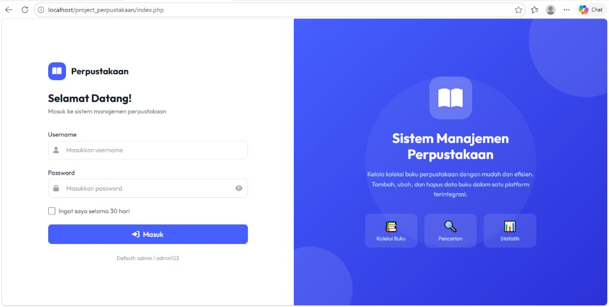
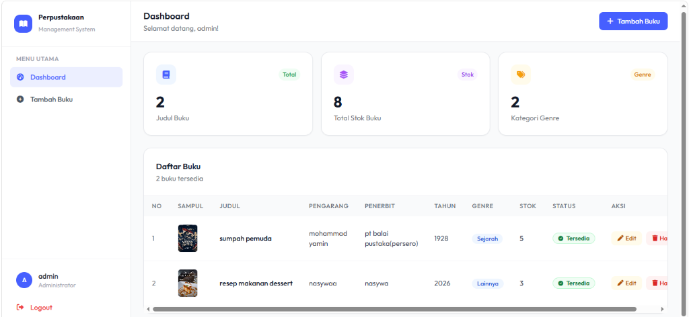
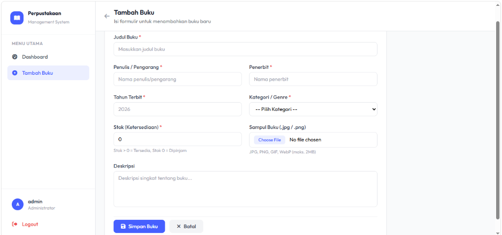

# Sistem Informasi Perpustakaan Digital Mini (Mini Digital Library)

Proyek tugas terstruktur mata kuliah **Pemrograman Web** - Program Studi Sistem Informasi.  
Aplikasi berbasis web menggunakan **PHP Native** dan **MySQL** dengan antarmuka modern (Tailwind CSS & FontAwesome) untuk mengelola data koleksi buku perpustakaan.

---

## 📋 Daftar Fitur Sesuai Ketentuan Tugas

### 1. Autentikasi & Hak Akses (Session & Cookie)
- **Halaman Login (`index.php`)**: Form login metode `POST` dengan verifikasi data pengguna (username & password).
- **Fitur Session**: Proteksi halaman `dashboard.php`, `tambah_buku.php`, `edit_buku.php`, dan `hapus_buku.php`. Pengguna yang belum login otomatis dialihkan ke halaman login.
- **Fitur Cookie ("Remember Me")**: Menyimpan identitas username di browser selama 30 hari. Ketika pengguna membuka kembali halaman login, username akan otomatis terisi.
- **Fitur Logout (`logout.php`)**: Menghapus seluruh session dan cookie secara aman serta me-redirect ke halaman login.

### 2. Pengelolaan Data Buku (CRUD MySQL)
- **Create (Tambah Data)**: Menambahkan data buku baru melalui form (Judul Buku, Penulis/Pengarang, Penerbit, Tahun Terbit, Kategori/Genre, Stok, Deskripsi, dan Sampul Buku).
- **Upload File Sampul**: Fasilitas upload berkas gambar sampul (`.jpg`, `.jpeg`, `.png`, `.webp`, `.gif`) dengan validasi ukuran berkas maksimal **2 MB**. Berkas disimpan di direktori server `uploads/` dan nama berkas dicatat di database.
- **Read (Tampil Data)**: Menampilkan seluruh daftar koleksi buku dalam bentuk tabel rapi dan informatif beserta thumbnail gambar sampul.
- **Update (Edit Data)**: Mengubah informasi buku yang sudah ada dengan opsi mengganti sampul baru atau mempertahankan sampul lama. Sampul lama akan dihapus dari server jika diganti.
- **Delete (Hapus Data)**: Menghapus data buku dari database sekaligus menghapus file gambar fisik dari folder server menggunakan fungsi PHP `unlink()`.

### 3. Logika Bisnis & Validasi (PHP Dasar & Percabangan)
- **Percabangan Status Ketersediaan**: Menggunakan logika `if-else` untuk menentukan badge status:
  - Jika **Stok > 0** $\rightarrow$ Status **"Tersedia"** (Badge Hijau).
  - Jika **Stok = 0** $\rightarrow$ Status **"Dipinjam"** (Badge Merah).
- **Validasi Berkas Upload**: Memvalidasi MIME type berkas gambar dan memastikan ukuran berkas tidak melebihi **2 MB**.

---

## 🗂️ Struktur Direktori Project

```text
project_perpustakaan/
├── config/
│   └── koneksi.php       # Koneksi ke database MySQL & auto-setup schema
├── uploads/              # Direktori penyimpanan file sampul buku (.gitkeep)
├── db_perpustakaan.sql   # Berkas ekspor skema & sampel database MySQL
├── database.sql          # Berkas alias skema database
├── index.php             # Halaman antarmuka login
├── proses_login.php      # Pemrosesan autentikasi login, session & cookie
├── logout.php            # Pembersihan session & cookie, redirect login
├── dashboard.php         # Halaman utama tampil data (Read), statistik & aksi
├── tambah_buku.php       # Formulir input penambahan buku (Create)
├── proses_tambah.php     # Pemrosesan query INSERT & upload file fisik
├── edit_buku.php         # Formulir perubahan data buku (Update)
├── proses_edit.php       # Pemrosesan query UPDATE & penggantian file fisik
├── hapus_buku.php        # Pemrosesan query DELETE & unlink file fisik
└── README.md             # Dokumentasi proyek & panduan pengumpulan
```

---

## 🗄️ Struktur Tabel Database MySQL (`db_perpustakaan`)

### Tabel `user`
| Kolom | Tipe Data | Keterangan |
| :--- | :--- | :--- |
| `id` | `INT AUTO_INCREMENT` | Primary Key |
| `username` | `VARCHAR(50)` | Unique, Username untuk login |
| `password` | `VARCHAR(255)` | Password hash (MD5 / Bcrypt) |

### Tabel `buku`
| Kolom | Tipe Data | Keterangan |
| :--- | :--- | :--- |
| `id` | `INT AUTO_INCREMENT` | Primary Key |
| `judul` | `VARCHAR(255)` | Judul lengkap buku |
| `pengarang` | `VARCHAR(255)` | Penulis/Pengarang buku |
| `penerbit` | `VARCHAR(255)` | Penerbit buku |
| `tahun_terbit` | `YEAR` | Tahun buku diterbitkan |
| `genre` | `VARCHAR(100)` | Kategori/Genre buku |
| `stok` | `INT` | Jumlah stok ketersediaan fisik |
| `sampul` | `VARCHAR(255)` | Nama berkas file di folder `uploads/` |
| `deskripsi` | `TEXT` | Sinopsis / ringkasan buku |
| `created_at` | `TIMESTAMP` | Waktu data ditambahkan |

---

## 🚀 Panduan Instalasi & Menjalankan Aplikasi

1. **Jalankan XAMPP**:
   - Aktifkan modul **Apache** dan **MySQL** pada XAMPP Control Panel.
2. **Penempatan Direktori**:
   - Pastikan folder project berada pada direktori:
     ```text
     C:\xampp\htdocs\project_perpustakaan
     ```
3. **Database Setup**:
   - Buka browser ke `http://localhost/phpmyadmin`.
   - Buat database baru dengan nama `db_perpustakaan` (atau biarkan aplikasi membuat otomatis saat pertama kali dibuka).
   - Import berkas `db_perpustakaan.sql` melalui tab **Import** pada phpMyAdmin.
4. **Buka Aplikasi**:
   - Akses melalui URL: **`http://localhost/project_perpustakaan`**
5. **Akun Login Default**:
   - **Username:** `admin`
   - **Password:** `admin123`

---

## 📸 Dokumentasi Screenshot Aplikasi

1. **Halaman Login & Fitur Remember Me (`index.php`)**
   

2. **Dashboard & Tabel Data Buku dengan Status Ketersediaan (`dashboard.php`)**
   

3. **Form Tambah Data & Upload Sampul (`tambah_buku.php`)**
   


---

## 🎥 Video Demo Aplikasi

- **Link Video YouTube**: `https://youtu.be/eg-HZse9-SM`

